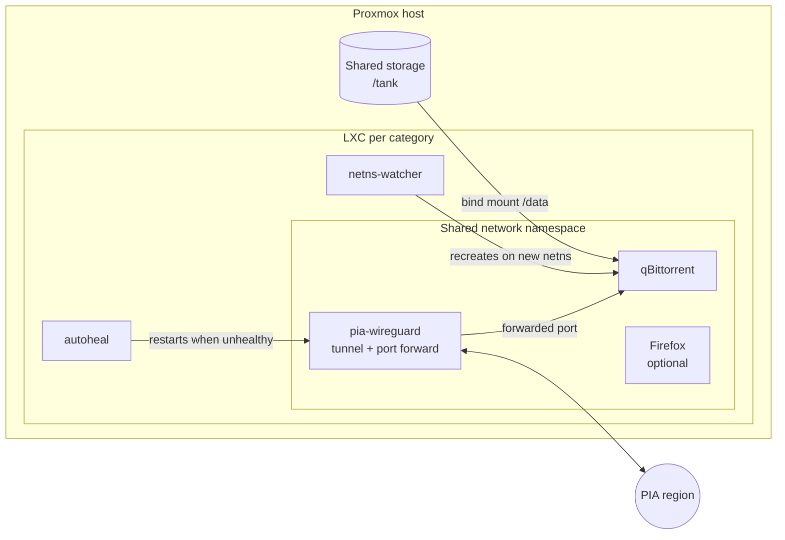

# proxmox-qbittorrent-pia

Terraform and Ansible for running a fleet of qBittorrent instances on Proxmox, each one behind its own Private Internet Access (PIA) WireGuard tunnel with port forwarding.

I run one instance per category (movies, TV, books, games and so on), each in its own unprivileged LXC with its own VPN exit region. That spreads upload bandwidth across several PIA servers and keeps one stuck tunnel from taking everything down. All the instances share one storage pool, so a container can be rebuilt from scratch and pick its torrents right back up.

This is the multi-host version of my single-host setup, [docker-qbittorrent-pia-wireguard](https://github.com/jq6l43d1/docker-qbittorrent-pia-wireguard). Most of the work here went into making it survive restarts, PIA outages and image updates without me touching it.

## How it fits together



| Layer | What does it |
|---|---|
| Containers | `terraform/` creates one unprivileged Ubuntu LXC per instance through the Proxmox API |
| Host config | `host/` scripts add `/dev/net/tun` and the `/data` bind mount, which need root@pam over SSH |
| Services | `ansible/` installs Docker, renders the compose stack and installs the systemd units |

Each LXC runs this Docker Compose stack:

- **pia-wireguard** ([thrnz/docker-wireguard-pia](https://github.com/thrnz/docker-wireguard-pia)) brings up the tunnel, keeps the forwarded port alive and firewalls everything else.
- **qbittorrent** ([linuxserver/qbittorrent](https://docs.linuxserver.io/images/docker-qbittorrent/)) shares the VPN container's network namespace, so it has no route out except the tunnel.
- **autoheal** restarts containers that go unhealthy, since Docker on its own only restarts containers that exit.
- **netns-watcher** is a small sidecar described below.
- **firefox** is optional. It browses through the same VPN IP as qBittorrent, which some private trackers want.

## Problems this solves

Each of these broke at least once before I fixed it.

**qBittorrent losing its network after a VPN restart.** qBittorrent joins the VPN container's network namespace. When the VPN container is recreated it gets a new namespace, but Docker leaves qBittorrent running in the old, dead one, and the WebUI just disappears. A plain `docker restart` fails because the old namespace is gone. `netns-watcher.sh` polls the VPN container's start time and, when it changes, stops qBittorrent gracefully and recreates it through Compose so it joins the new namespace.

**Port forwarding dying while the tunnel stays up.** PIA's port forward API can go down for a whole cluster while WireGuard still connects fine. The image's own fallback only kicks in when registration fails, so it reconnects to the same broken region forever. `pia-entrypoint.sh` wraps the image's entrypoint and rotates through a per-host region list (`pia_loc` plus `pia_loc_fallbacks`) on every restart. Once a region stays healthy for ten minutes it sticks, so routine restarts don't move it.

**Torrents disappearing after restarts.** With about 1,700 torrents loaded, qBittorrent's shutdown save didn't finish before the container was killed, and anything added since the last full save vanished from the session. On private trackers that turns into hit-and-run warnings. The fix had several parts:

- Raise the s6 and Docker stop grace periods so qBittorrent gets two minutes to shut down.
- Switch resume data from per-torrent files to qBittorrent's SQLite backend, which saves each torrent when it's added.
- Save resume data every 5 minutes instead of every 60.
- Make every scripted restart stop qBittorrent with SIGTERM first.

**The forwarded port changing.** A custom-init script reads the port PIA forwarded and writes it into `qBittorrent.conf` on every start. It also binds qBittorrent to `wg0`, turns off UPnP and sets the WebUI password.

**WebUI unreachable on qBittorrent 5.** Qt 6 turns `WebUI\Address=*` into an IPv6 dual-stack listener. The VPN container disables IPv6 on `eth0` to prevent leaks, so IPv4 connections never reach it. The init script binds `0.0.0.0` explicitly.

**qBittorrent refusing to start.** A lockfile from the previous container makes qBittorrent think another machine holds the lock, and it quietly exits in a loop. A custom-init script clears it on boot.

**Nightly updates filling the disk.** The update timer pulls new images and force-recreates the whole stack. If the disk filled mid-pull, every later run failed before reaching the cleanup step, which made things worse each night. It now prunes old images before pulling as well as after.

## Setup

You need a Proxmox host, a PIA subscription, Terraform and Ansible.

**1. Create the containers.**

```bash
cd terraform
cp terraform.tfvars.example terraform.tfvars   # API token, gateway, instances
terraform init
terraform apply
```

**2. Add the TUN device and storage mount.** These edit the LXC config directly, which an API token isn't allowed to do.

```bash
PVE=root@192.168.1.10 VMIDS="151 152 153 154" host/apply-tun-passthrough.sh
PVE=root@192.168.1.10 STORAGE=/tank \
  INSTANCES="151:movies 152:tv 153:books 154:games" host/apply-data-mounts.sh
```

**3. Store the secrets.** Generate the WebUI password hash, then put it and your PIA login in an encrypted vault file.

```bash
python3 scripts/qbt-password-hash.py
cd ansible
cp vault.example.yml group_vars/qbittorrent/vault.yml
$EDITOR group_vars/qbittorrent/vault.yml
ansible-vault encrypt group_vars/qbittorrent/vault.yml
```

**4. Deploy.**

```bash
cp inventory.example.yml inventory.yml   # IPs, instance names, PIA regions
ansible-playbook site.yml --ask-vault-pass
```

Each WebUI is at `http://<lxc-ip>:8080`.

## Per-instance options

Set these on a host in the inventory. Defaults are in `ansible/roles/qbittorrent-pia/defaults/main.yml`.

| Variable | Default | Purpose |
|---|---|---|
| `qbt_instance` | required | Short name for the stack, containers and config dir |
| `pia_loc` | required | Preferred PIA region (must support port forwarding) |
| `pia_loc_fallbacks` | `[]` | Regions to rotate through when port forwarding dies |
| `qbt_save_path` | qBittorrent default | Default download location, e.g. `/data/games` |
| `qbt_webui_title` | none | Instance name shown in the browser tab |
| `qbt_vuetorrent` | `false` | Serve [VueTorrent](https://github.com/VueTorrent/VueTorrent) as the WebUI |
| `qbt_incomplete_ext` | `false` | Add `.!qB` to unfinished files so scripts can skip them |
| `qbt_firefox` | `false` | Add a Firefox container that uses the same VPN |
| `qbt_local_networks` | private ranges | Networks allowed through the VPN firewall to the WebUI |

Pick regions for `pia_loc_fallbacks` on different PIA clusters. Nearby virtual regions are often hosted together and go down together. Run `/scripts/wg-gen.sh -a` inside a PIA container to list the regions that support port forwarding.

## Repository layout

```
terraform/          LXC containers via the Telmate Proxmox provider
host/               Proxmox host scripts for /dev/net/tun and the /data bind mount
ansible/
  site.yml
  inventory.example.yml
  vault.example.yml
  group_vars/qbittorrent/vars.yml
  roles/qbittorrent-pia/
    templates/compose.yaml.j2         the per-instance Docker Compose stack
    files/pia-entrypoint.sh           PIA region failover
    files/netns-watcher.sh            reattach qBittorrent to a new VPN namespace
    files/custom-init/                scripts run by the qBittorrent container on every start
    templates/qbt-auto-update.*       nightly image update timer
scripts/qbt-password-hash.py          generate the WebUI password hash
```

## License

MIT
